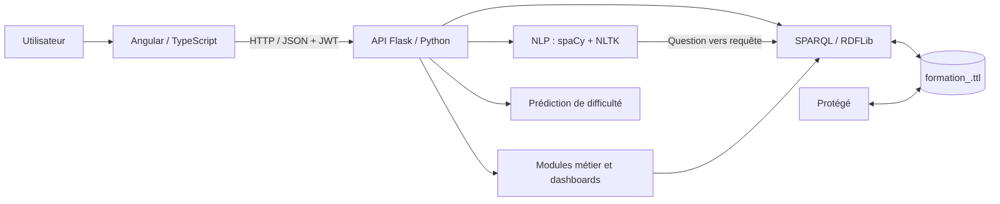

<div align="center">

# 🎓 StackUnity — Éducation & Formation

### Plateforme web de gestion et d'exploration d'une ontologie éducative

**Angular · TypeScript · Python · Flask · RDFLib · OWL · SPARQL · NLP · Machine Learning**

[](https://angular.dev/)
[](https://flask.palletsprojects.com/)
[](https://www.python.org/)
[](https://www.w3.org/standards/semanticweb/)

**Groupe : StackUnity**  
*Projet académique collaboratif — Web sémantique / Éducation & Formation*

</div>

---

## 📖 Présentation

**StackUnity** est une application web de gestion des données du domaine **Éducation & Formation** s'appuyant sur une **ontologie OWL**. Elle relie une interface Angular à une API Flask qui lit, interroge et met à jour le graphe RDF à l'aide de RDFLib et du langage SPARQL.

Le projet rassemble **10 modules métier**, la gestion des classes, instances et propriétés de l'ontologie, des **tableaux de bord adaptés aux rôles**, une **bibliothèque SPARQL**, des **assistants NLP** pour transformer des questions en français en requêtes SPARQL, ainsi qu'un module de **prédiction de difficulté des matières**.

### ✨ Fonctionnalités principales

- **Gestion CRUD de l'ontologie** : création, lecture, modification et suppression des classes, instances et propriétés RDF/OWL.
- **Navigation sémantique** : hiérarchies de classes, fiches d'entités, liens et relations entre individus.
- **Recherche et requêtes SPARQL** : console de requêtes et bibliothèque de 16 exemples.
- **Authentification JWT et rôles** : accès contextualisé et tableaux de bord personnalisés.
- **Assistant IA NLP avancé** : analyse des questions en français, reconnaissance d'entités, détection d'intentions et génération de requêtes SPARQL.
- **Assistant NLP Personnes & Organismes** : questions de listage et de comptage sur les apprenants, enseignants, tuteurs, universités, entreprises, laboratoires, etc.
- **Prédiction de difficulté** : classification *Facile / Moyenne / Difficile* à partir d'un jeu de données de résultats pédagogiques, avec règles de secours lorsque le modèle n'est pas disponible.
- **Synchronisation avec Protégé** : les opérations d'édition sont répercutées sur le fichier Turtle de l'ontologie.

## 🛠️ Technologies et frameworks

| Couche | Technologies | Utilisation |
|---|---|---|
| **Frontend** | **Angular**, **TypeScript**, HTML, CSS, Angular Router, Angular HttpClient | Interface, composants, navigation, formulaires et appels API |
| **Backend** | **Python**, **Flask** | API REST, gestion des modules, validation et orchestration des requêtes |
| **Web sémantique** | **RDF**, **RDFS**, **OWL**, **Turtle (TTL)**, **SPARQL** | Modélisation et interrogation des connaissances |
| **Moteur RDF** | **RDFLib** | Chargement, requêtes et écriture du graphe RDF |
| **Modélisation** | **Protégé** | Création, visualisation et inspection de l'ontologie |
| **NLP / TALN** | **spaCy**, **NLTK** (SnowballStemmer), **difflib** | Tokenisation, lemmatisation, racinisation, synonymes, rapprochement des termes |
| **Machine Learning** | **Random Forest** (bibliothèque ML utilisée par le module de prédiction à vérifier dans le code du dépôt) | Estimation de la difficulté pédagogique |
| **Sécurité** | **JWT** (PyJWT), gardes de routes Angular | Authentification et contrôle d'accès |
| **Outils collaboratifs** | **Git**, **GitHub**, npm, pip | Versionnement, branches, intégration et installation |

> La version exacte des bibliothèques est définie dans `backend/requirements.txt` et `frontend/package.json`. Le fichier README d'origine ne précise pas la bibliothèque Python utilisée pour entraîner le Random Forest ; vérifier `train_model.py` pour la confirmer.

## 🏗️ Architecture



**Fonctionnement :**

1. L'utilisateur interagit avec les pages Angular ; les formulaires et composants transmettent les demandes au service HTTP centralisé.
2. Flask reçoit les requêtes JSON, contrôle l'authentification et délègue les opérations aux blueprints des modules concernés.
3. RDFLib consulte ou modifie le graphe de connaissances enregistré dans `backend/ontology/formation_.ttl`.
4. Les assistants NLP interprètent des questions en français, génèrent du SPARQL et affichent les résultats renvoyés par l'API.
5. Les modifications des classes, propriétés ou instances sont **persistées dans le fichier TTL**. Une sauvegarde `formation_.ttl.bak` est créée au premier enregistrement.
6. Dans Protégé, il est possible d'ouvrir le même fichier TTL et de le rouvrir après les modifications effectuées depuis l'application.

## 🧩 Les 10 modules métier

Chaque module possède son **sous-arbre dans l'ontologie**, son **blueprint Flask** et sa **page Angular**.

| Route | Domaine | Classes documentées |
|---|---|---:|
| `/personnes` | Personnes, apprenants, enseignants, tuteurs, personnel médical | 17 |
| `/formations` | Formations, diplômes, compétences, certifications, parcours | 42 |
| `/matieres` | Matières, séances, évaluations, ressources pédagogiques | 26 |
| `/clubs` | Clubs et événements | 26 |
| `/organismes` | Universités, entreprises, laboratoires, stages | 17 |
| `/espaces` | Espaces et ressources associées | 9 |
| `/inscriptions` | Inscriptions | 4 |
| `/bourses` | Bourses | 4 |
| `/sante` | Services médicaux | 25 |
| `/vie` | Vie étudiante | 17 |

L'ontologie documentée couvre **187 classes**. Le module **Propriétés** permet également de gérer les `owl:ObjectProperty` et `owl:DatatypeProperty`.

### 🔗 Exemple de relations sémantiques

Le projet met en relation des concepts tels que **Personne**, **Organisme** et **Stage**. Un apprenant peut être associé à un stage, lequel est lié à un organisme d'accueil. Les noms et domaines précis des propriétés doivent être consultés dans `formation_.ttl` pour éviter de créer des relations en double.

## 🤖 Intelligence artificielle et traitement du langage naturel

### 1. Assistant NLP avancé de l'équipe

L'assistant traduit des questions françaises en SPARQL **sans recours à une API externe de grand modèle de langage**. Le pipeline documenté est le suivant :

```text
Question en français
       ↓
Tokenisation / lemmatisation spaCy
       ↓
Racinisation NLTK (SnowballStemmer français)
       ↓
Lexique de l'ontologie + synonymes métier
       ↓
Reconnaissance des classes, propriétés et individus
       ↓
Détection d'intention et extraction de contraintes
       ↓
Génération d'une requête SPARQL guidée par le schéma
       ↓
Exécution via RDFLib → résultats affichés dans Angular
```

Les intentions prises en charge par le moteur avancé incluent notamment **listage, comptage, existence, description, regroupement**, ainsi que certaines comparaisons et contraintes numériques. Les dépendances NLP disposent de mécanismes de repli lorsque le modèle spaCy ou NLTK n'est pas disponible, mais leur installation est recommandée.

### 2. Assistant NLP — Personnes & Organismes

Un assistant dédié permet de saisir des questions simples en français pour **lister ou compter** les individus des classes du domaine *Personnes et Organismes*.

| Question d'exemple | Classe détectée | Intention |
|---|---|---|
| « Montre les étudiants » | `Apprenant` | Lister |
| « Combien de personnes ? » | `Personne` | Compter |
| « Affiche les enseignants » | `Enseignant` | Lister |
| « Liste les entreprises » | `Entreprise` | Lister |
| « Montre les universités » | `Universite` | Lister |

**Implémentation :** `backend/nlp.py` (fonction `generer_sparql`), `POST /api/nlp` dans `backend/app.py`, `frontend/src/app/core/api.service.ts` et `frontend/src/app/features/assistant/assistant.component.ts`. Route Angular : `/assistant`.

> Les réponses dépendent des classes et des individus effectivement présents dans l'ontologie. En cas d'erreur, consulter le terminal Flask pour distinguer les problèmes de traitement NLP de ceux liés à la requête SPARQL.

### 3. Prédiction de difficulté des matières

Le module de prédiction utilise un **Random Forest** entraîné sur des statistiques **agrégées par matière** à partir de `backend/tests/data.csv` : **800 notes**, **10 matières**, **80 résultats par matière** dans le jeu documenté.

- **Difficile** : taux de réussite jusqu'à **40 %** ; **Facile** : à partir de **75 %** ; **Moyenne** : entre les deux.
- Découpage stratifié documenté : **7 matières d'entraînement** et **3 matières de test**.
- Dernière évaluation mentionnée dans le README d'origine : **accuracy 0,667**, **précision macro 0,500**, **rappel macro 0,667**, **F1 macro 0,556**.
- Le score `confiance_pct` provient de `predict_proba` : **il n'est pas calibré** et ne constitue pas une garantie de fiabilité.
- En l'absence de modèle exploitable, une estimation par règles peut utiliser le taux de réussite lié à une formation, le coefficient et le volume horaire. Ce mécanisme de secours **n'est pas du machine learning**.

**Limite importante :** dix matières constituent un jeu de données trop restreint pour démontrer une généralisation fiable du modèle.

## 🚀 Installation et lancement

### Prérequis

- **Python** et `pip` (version compatible avec les dépendances du projet)
- **Node.js** et **npm** (la version exacte requise dépend de `frontend/package.json`)
- **Git**
- **Protégé** *(facultatif pour inspecter l'ontologie)*

### 1. Cloner le dépôt

```bash
git clone https://github.com/fedimbarek/StackUnity-Educationv.git
cd StackUnity-Educationv
```

### 2. Lancer le backend — Windows PowerShell

```powershell
cd backend
python -m venv venv
.\venv\Scripts\Activate.ps1
python -m pip install -r requirements.txt
python -m spacy download fr_core_news_sm
python app.py
```

Le serveur Flask est accessible à **http://127.0.0.1:5000**.

> Si PowerShell refuse l'activation du venv, utiliser directement `\.venv\Scripts\python.exe` *uniquement si l'environnement porte effectivement ce nom*, ou lancer `venv\Scripts\python.exe app.py` depuis `backend`.

### 3. Lancer le frontend — second terminal

À partir de la racine du projet :

```powershell
cd frontend
npm install
npm start
```

L'interface est accessible à **http://localhost:4200**.

### 4. Installation sous Linux / macOS

Dans `backend` :

```bash
python3 -m venv venv
source venv/bin/activate
python -m pip install -r requirements.txt
python -m spacy download fr_core_news_sm
python app.py
```

Dans un autre terminal, depuis `frontend` :

```bash
npm install
npm start
```

### 5. Démarrage quotidien (après installation)

| Terminal | Commandes |
|---|---|
| Backend | `cd backend` → `venv\Scripts\Activate.ps1` → `python app.py` |
| Frontend | `cd frontend` → `npm start` |

## 🔐 Connexion et gestion des rôles

**Compte de démonstration administrateur** (pour un environnement local de test uniquement) :

```text
Identifiant : admin
Mot de passe : admin123
```

Les comptes de démonstration par profil utilisent le mot de passe `demo123` dans la configuration documentée : `amira` (apprenant), `bilel` (stagiaire), `ahmed` et `walid` (enseignants), `drsonia` (médecin), `mariem` (psychologue), `rim` (responsable de club), `mehdi` (tuteur d'entreprise) et `sami` (tuteur). Leur création automatique peut être désactivée via `SEED_DEMO_USERS=0`.

> **Sécurité :** ces identifiants sont destinés à la démonstration. Ne jamais les conserver pour une mise en production. Les comptes sont enregistrés dans `backend/users.json` selon la documentation initiale.

Les comptes liés à une personne de l'ontologie se voient attribuer un rôle dérivé de sa classe. L'interface et les modules visibles sont adaptés via `backend/roles.py`, `backend/dashboard.py` et les contrôles d'accès Angular (`core/roles.ts`).

| Profil | Exemple de contenu du tableau de bord |
|---|---|
| Apprenant | Formations, inscriptions, évaluations, clubs, stages, bourses |
| Enseignant | Matières, séances, apprenants, stages encadrés |
| Médical | Services, bénéficiaires, certificats |
| Responsable de club | Clubs, membres, événements |
| Tuteur | Apprenants tutorés et stages |
| Tuteur d'entreprise | Stages supervisés, stagiaires, organismes |
| Admin | Vue globale, administration et outils avancés |

L'accès aux modules métier est contrôlé par `authGuard` et `accessGuard`. Dans l'intégration récente, **`/assistant` requiert une authentification**, tandis que les outils avancés de l'équipe sont affichés conditionnellement selon les droits du rôle.

## 🔌 API REST — principales routes

Les routes protégées nécessitent le header `Authorization: Bearer <JWT>`.

| Méthode | Endpoint | Description |
|---|---|---|
| POST | `/api/auth/login` | Authentification |
| POST | `/api/auth/register` | Inscription |
| GET | `/api/auth/profiles` | Profils disponibles |
| GET | `/api/me/dashboard` | Tableau de bord personnalisé |
| GET | `/api/modules` | Liste des modules |
| GET | `/api/stats` | Statistiques globales |
| GET | `/api/search?q=...` | Recherche globale |
| POST | `/api/sparql` | Exécution de requêtes de lecture |
| POST | `/api/sparql/update` | Mise à jour SPARQL, selon autorisation |
| GET | `/api/queries` | Bibliothèque SPARQL |
| POST | `/api/ai/ask` | Assistant NLP avancé |
| POST | `/api/nlp` | Assistant Personnes & Organismes |
| POST | `/api/ai/explain` | Explication d'entité |
| GET | `/api/ai/recommend/<id>` | Recommandations |
| GET | `/api/ai/status` | État du moteur NLP |
| POST | `/api/prediction/difficulte` | Prédiction de difficulté d'une matière |
| GET | `/api/export.ttl` | Export de l'ontologie |
| GET/POST | `/api/properties` | Propriétés de l'ontologie |
| GET/POST | `/api/<module>/classes` | Classes d'un module |
| GET/POST | `/api/<module>/items` | Instances d'un module |

Les routes de détail, modification et suppression des classes, propriétés ou instances suivent les conventions REST (`GET`, `PUT`, `DELETE`) documentées dans les blueprints.

### Exemple de requête à l'assistant NLP

```http
POST /api/nlp
Authorization: Bearer <JWT>
Content-Type: application/json

{"question": "Montre les étudiants"}
```

Réponse attendue : question, classe reconnue, intention, SPARQL généré et résultats. Les données retournées varient selon le contenu actuel de l'ontologie.

### Exemple : prédiction de difficulté

```http
POST /api/prediction/difficulte
Authorization: Bearer <JWT>
Content-Type: application/json

{"id": "Mathematiques"}
```

Codes documentés : `400` (requête invalide), `404` (matière inconnue), `422` (pas d'indicateur exploitable) et `500` (erreur interne).

Pour entraîner le modèle, depuis `backend` :

```bash
python -m pip install -r requirements.txt
python train_model.py
```

Le modèle entraîné est enregistré dans `backend/models/difficulty_model.pkl`. Il est possible de configurer le CSV via `DIFFICULTY_DATASET_PATH` et les seuils via `DIFFICULTY_HARD_MAX_SUCCESS_RATE`, `DIFFICULTY_EASY_MIN_SUCCESS_RATE` et les variables `DIFFICULTY_*` correspondantes aux règles de secours.

## 📁 Organisation du projet

```text
StackUnity-Educationv/
├── backend/
│   ├── app.py                   # Point d'entrée Flask et routes
│   ├── auth.py                  # Authentification JWT
│   ├── dashboard.py             # Tableaux de bord selon les rôles
│   ├── roles.py                 # Mapping profils / classes RDF
│   ├── modules.py               # Blueprints métier / CRUD
│   ├── nlp.py                   # TALN et génération SPARQL
│   ├── ai.py                    # API de l'assistant avancé
│   ├── queries.py               # Bibliothèque de requêtes
│   ├── schema.py                # Gestion des propriétés
│   ├── misc.py                  # APIs transversales
│   ├── store.py                 # Lecture / écriture RDFLib
│   ├── train_model.py           # Entraînement ML (selon README initial)
│   ├── ontology/
│   │   └── formation_.ttl       # Ontologie OWL / Turtle
│   ├── tests/
│   │   └── data.csv             # Données d'apprentissage documentées
│   └── requirements.txt
├── frontend/
│   └── src/app/
│       ├── core/                # Auth, services HTTP, rôles, modules
│       ├── shared/              # Composants Angular réutilisables
│       ├── pages/               # Login, accueil, IA, SPARQL, scénario
│       ├── features/            # Modules métier
│       │   └── assistant/
│       │       └── assistant.component.ts
│       ├── app.routes.ts        # Routes Angular
│       └── app.component.ts     # Navigation / layout principal
├── GUIDE_VALIDATION.md          # Scénarios de validation (si présent)
└── README.md
```

*Cette arborescence reprend les chemins documentés et ceux utilisés lors de l'intégration de l'assistant. Vérifier les fichiers présents dans la branche choisie.*

## 👥 Méthode de travail et collaboration

Le développement est organisé **par modules fonctionnels**, avec un découpage entre **modèle ontologique**, **API Flask** et **composants Angular**.

1. **Conception de l'ontologie** dans Protégé : identification des classes, sous-classes, individus, propriétés et relations entre les domaines.
2. **Persistance RDF** dans `formation_.ttl` et interrogation avec RDFLib/SPARQL.
3. **Développement backend** : endpoints REST et blueprints par module, authentification JWT et services de traitement NLP.
4. **Développement frontend** : pages Angular par domaine, composants CRUD partagés, navigation et appels API via `api.service.ts`.
5. **Intégration des modules IA** : génération SPARQL à partir du langage naturel et prédiction statistique des difficultés pédagogiques.
6. **Travail en branches Git** : commits par fonctionnalité, publication sur GitHub, Pull Requests vers `main` et vérification des conflits avant fusion.
7. **Validation** : vérification du démarrage, des appels API, des requêtes SPARQL, de la navigation et de la cohérence des données TTL.

### Contribuer sans écraser le travail des autres

```bash
git switch main
git pull origin main
git switch -c feature/ma-fonctionnalite
# Modifier puis tester le code
git add .
git commit -m "feat: ajout de ma fonctionnalite"
git push -u origin feature/ma-fonctionnalite
```

Créer ensuite une **Pull Request vers `main`**, inspecter l'onglet *Files changed* et résoudre les éventuels conflits avant fusion.

## ✅ Vérification et dépannage

```powershell
# Depuis backend
python -m py_compile app.py nlp.py
python app.py

# Depuis frontend (dans un autre terminal)
npm run build
npm start
```

- **Erreur NLP / SPARQL** : lire le *traceback* dans le terminal Flask ; l'erreur générique renvoyée au frontend ne suffit pas à identifier la cause.
- **Erreur de modèle spaCy** : exécuter `python -m spacy download fr_core_news_sm` dans l'environnement virtuel activé.
- **Problème npm / esbuild** : vérifier les versions installées, les variables `ESBUILD_*`, le cache et réinstaller les dépendances sans supprimer arbitrairement le verrouillage des versions.
- **Données non visibles dans Protégé** : rouvrir le fichier `backend/ontology/formation_.ttl` après une modification effectuée depuis l'application.
- **Accès refusé** : vérifier l'authentification JWT, le rôle de l'utilisateur et les contrôles de routes Angular.

Pour les scénarios de démonstration détaillés, consulter `GUIDE_VALIDATION.md` si ce document est présent dans le dépôt.

---

## 👥 Équipe du projet — StackUnity

Le projet **StackUnity — Éducation & Formation** est réalisé en collaboration par les cinq membres du groupe **StackUnity** :

| Membre | Groupe |
|---|---|
| **Mohamed Dhia Romdhane** | StackUnity |
| **Firas Nefzi** | StackUnity |
| **Fedi Mbarek Abidi** | StackUnity |
| **Oussema Saideni** | StackUnity |
| **Farah Hammami** | StackUnity |

Chaque membre contribue à la conception, au développement et à l'intégration du projet dans le cadre du travail d'équipe.

---

<div align="center">

**StackUnity — Donner du sens aux données éducatives grâce au Web sémantique.**

*Angular • Flask • Protégé • RDFLib • SPARQL • NLP*

</div>
